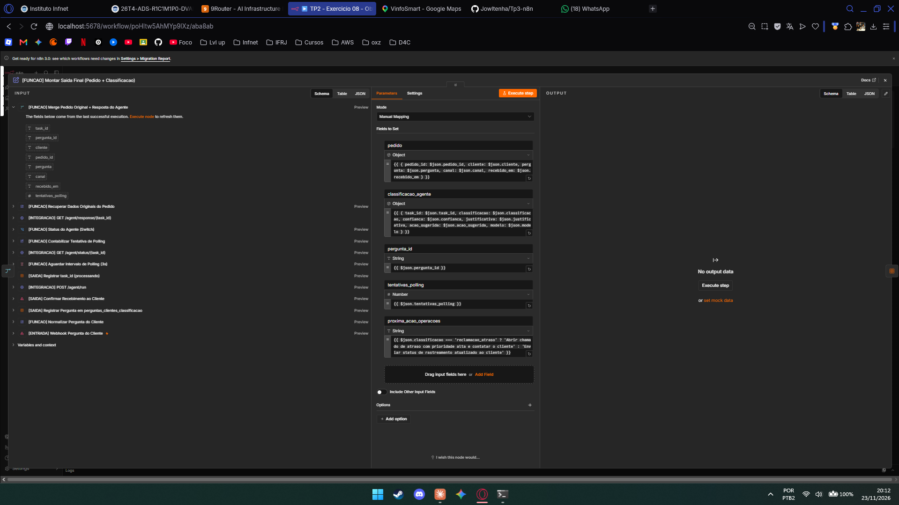

# Exercício 1 - Automação Tradicional x Comportamento Agêntico nos Workflows da Vórtice Logística

## 1. Contexto
A diretoria passou a desconfiar do termo "agente" depois de ouvi-lo em reuniões com fornecedores para descrever quase qualquer automação. Para mostrar ao time onde fica a fronteira entre automação tradicional e comportamento agêntico, foram revisados os workflows já entregues no TP1 (coleta, normalização, triagem de risco e validação de CEP) e no TP2 (monitoramento de falhas, Merge, Code node e integração com o agente de classificação).

A régua usada na análise é simples:

* **Automação tradicional**: quem decide é uma regra escrita antes pelo desenvolvedor (um If, um dicionário, um limite numérico, um texto fixo). Para a mesma entrada, o resultado é sempre o mesmo. Se a entrada sair do previsto, a regra falha ou cai no valor padrão.
* **Comportamento agêntico**: quem decide é um modelo de linguagem, a partir do significado da entrada e de um objetivo, e não de um caminho programado para cada caso. O modelo lida com entradas que ninguém previu e escolhe o que fazer. Nos níveis mais altos, ele também decide quais ferramentas usar e em que ordem.

## 2. Oito Regras Determinísticas que Poderiam Ser Decididas por um LLM
A numeração das tarefas segue a ordem em que cada item foi pedido no enunciado de cada exercício.

| # | TP | Exercício | Tarefa | Nó do workflow | Regra determinística atual | Como um LLM decidiria |
|---|----|-----------|--------|----------------|----------------------------|------------------------|
| 1 | TP1 | 3 | 2 | `[FUNCAO] Limitar Lote Prioritario` (Limit), depois de `[FUNCAO] Ordenar por Data de Coleta` (Sort) | O lote prioritário são sempre os 3 pedidos mais antigos (`maxItems = 3` sobre a ordenação por `data`). | Montar o lote prioritário pelo contexto de cada pedido (cliente crítico, carga perecível, observação do remetente), e não só pela data. |
| 2 | TP1 | 4 | 1 | `[FUNCAO] Normalizar Dados (Edit Fields)`, campo `status` | Dicionário fixo: `requested` vira `pendente`, `processando` vira `em_processamento`, `delivered` e `encerrado` viram `entregue`. Qualquer outro valor cai em `indefinido`. | Entender variações que não estão no dicionário (`em rota`, `shipped`, `aguardando retirada`) e mapear para o status padrão mais próximo. |
| 3 | TP1 | 4 | 1 | `[FUNCAO] Normalizar Dados (Edit Fields)`, campo `data` | Se a data tem `/`, é lida como `dd/MM/yyyy` (com `HH:mm` se tiver `:`). Caso contrário, é lida como ISO. Qualquer outro formato quebra a conversão. | Interpretar formatos livres, como "30 de julho", "ontem às 10h" ou `07-30-2024`, e devolver a data ISO. |
| 4 | TP1 | 6 | 1 | `[FUNCAO] Avaliar Risco (Valor > 1000)` (If) | Pedido com `valor` acima de R$ 1.000,00 vai para conferência de seguro. Os demais são aprovados direto. | Avaliar o risco pelo conjunto: valor, tipo de carga, histórico do cliente e rota, justificando a decisão em texto. |
| 5 | TP1 | 7 | 2 | `[FUNCAO] Tratar Resposta e Enriquecer Endereco` (Code) e `[FUNCAO] Validar CEP Valido (If)` | O CEP é válido se o ViaCEP não devolver `erro` e devolver o campo `cep`. Caso contrário, o pedido vai para `pedidos_invalidos` com motivo fixo. | Comparar o endereço digitado pelo cliente com o retorno do ViaCEP, perceber erros de digitação (um dígito trocado) e sugerir a correção em vez de só rejeitar. |
| 6 | TP2 | 1 | 1 | `[FUNCAO] Extrair Dados da Falha` (Edit Fields), campo `alerta_operacoes` | O alerta é sempre o mesmo modelo de texto: "[ALERTA OPERACOES] Falha no workflow X no nó Y: mensagem". Toda falha tem o mesmo peso. | Ler a mensagem de erro, classificar a gravidade (configuração, indisponibilidade externa, dado inválido) e sugerir a primeira ação de correção. |
| 7 | TP2 | 8 | 2 | `[FUNCAO] Montar Saida Final (Pedido + Classificacao)` (Edit Fields), campo `proxima_acao_operacoes` | Ternário fixo: se `classificacao === 'reclamacao_atraso'`, "Abrir chamado de atraso com prioridade alta e contatar o cliente". Senão, "Enviar status de rastreamento atualizado ao cliente". | Definir a próxima ação a partir da pergunta e da classificação, por exemplo pedir foto da avaria, oferecer reagendamento ou só informar a previsão. |
| 8 | TP2 | 10 | 2 | `[FUNCAO] Preparar Erro de Resposta Vazia` (Edit Fields), campo `mensagem_amigavel` | O cliente sempre recebe o mesmo texto fixo: "Recebemos sua pergunta, mas a classificação automática não ficou disponível...". | Escrever uma resposta que leve em conta o que o cliente perguntou, mantendo o aviso de que um atendente vai assumir o caso. |

Observação importante para a diretoria: trocar uma regra por um LLM não é automaticamente uma melhoria. Regras como a validação do contrato da resposta do agente (`[FUNCAO] Resposta do Agente Contem Classificacao?`, TP2 Ex10) ou o limite de tentativas do polling (`[FUNCAO] Contabilizar Tentativa de Polling`, TP2 Ex7) devem continuar determinísticas, porque precisam ser previsíveis e auditáveis. O LLM vale a pena onde a entrada é linguagem natural ou varia demais para caber num dicionário ou num If.

## 3. Nós que Dependem de um LLM
No TP1 nenhum nó depende de um LLM: todas as decisões são regras fixas (Sort, Limit, Edit Fields com dicionário, If com limite numérico e Code com a validação do CEP). O TP1 inteiro é automação tradicional.

No TP2, a dependência de LLM aparece a partir do Exercício 6, quando o workflow passa a chamar o agente Python de classificação (FastAPI com o modelo OpenAI `gpt-4o-mini`):

* `[INTEGRACAO] POST /agent/run` (HTTP Request, Exercícios 6 a 10): envia a pergunta do cliente ao agente, que dispara a classificação pelo LLM em segundo plano.
* `[INTEGRACAO] GET /agent/status/{task_id}` (HTTP Request, Exercícios 6 a 10): acompanha o processamento do modelo durante o polling.
* `[INTEGRACAO] GET /agent/response/{task_id}` (HTTP Request, Exercícios 8 a 10): traz a decisão do modelo (`classificacao`, `confianca`, `justificativa` e `acao_sugerida`), que depois é recombinada com o pedido no Merge.

Esses nós são HTTP comuns. O que se qualifica como comportamento agêntico é a decisão que chega por eles, e não o nó em si:

* **A decisão não está escrita no workflow.** Nenhum If ou dicionário diz que "ninguém apareceu" é `reclamacao_atraso` e que "quando chega?" é `rastreamento`. O modelo infere a categoria pelo sentido da frase, inclusive em mensagens que nunca foram vistas.
* **Ele lida com linguagem natural não estruturada.** As regras do TP1 só funcionam com campos previsíveis (`valor`, `status`, `cep`). O agente recebe texto livre, com erros de digitação, ironia ou tom de reclamação, e ainda assim chega a uma categoria.
* **A saída muda o caminho do fluxo.** A `classificacao` devolvida pelo modelo define a `proxima_acao_operacoes` e o que é gravado na Data Table. O LLM escolhe o caminho, coisa que um tradutor de formatos não faz.
* **Ele explica e calibra a decisão.** O agente devolve `confianca` e `justificativa`, avaliando a própria certeza, algo que uma regra determinística não tem como fazer.
* **O resultado não é idêntico a cada execução.** Para a mesma pergunta, a justificativa pode variar. Por isso o TP2 precisou de validação de contrato (Ex10) e de tratamento de erro: é a contrapartida de dar autonomia de decisão a um modelo.

## 4. Conclusão: Nível de Agência dos Workflows Atuais
Pela escala de níveis de agentes vista na disciplina, que vai da automação por regras até sistemas multiagente autônomos, os workflows atuais da Vórtice Logística estão nos primeiros degraus:

* **TP1: nível 0 (automação tradicional, sem agência).** O fluxo é inteiramente determinístico e não há modelo de linguagem envolvido.
* **TP2: nível 1 (LLM como roteador / classificador de etapa única).** O LLM toma uma decisão pontual, a categoria da pergunta, e essa decisão escolhe o caminho seguinte do workflow. Mas o modelo não escolhe ferramentas, não consulta sistemas (não sabe o status real do pedido), não tem memória entre mensagens e não decide se precisa de mais passos. O ciclo, o polling, os limites e o tratamento de erros continuam todos sob controle do workflow.

Na prática, a Vórtice tem hoje um **classificador com LLM dentro de uma automação**, e não um agente autônomo. A próxima etapa, construída nos Exercícios 4 a 9 deste TP, é subir de nível: um Agent node que decide quando acionar ferramentas (consulta de status do pedido), com saída estruturada, sub-workflows reutilizáveis e memória da conversa. Esse vocabulário dá à diretoria um critério objetivo para avaliar propostas de fornecedores: perguntar quem toma a decisão (regra ou modelo), se o modelo pode agir em sistemas reais por meio de ferramentas e se ele mantém contexto entre interações.

## 5. Arquivos Analisados
* TP1: `workflow_exercicio_03.json`, `workflow_exercicio_04.json`, `workflow_exercicio_06.json` e `workflow_exercicio_07.json`.
* TP2: `workflow_exercicio_01_error_workflow.json`, `workflow_exercicio_06.json` a `workflow_exercicio_10.json` e o agente `agente/app.py`.

## 6. Evidências de Execução
Capturas em tela cheia, com data e hora visíveis, dos nós citados na análise, abertos nos workflows originais.

![TP1 Ex06: nó [FUNCAO] Avaliar Risco (Valor > 1000) com a regra fixa valor maior que 1000](prints/exercicio_01_regra_if_risco_tp1.png)

