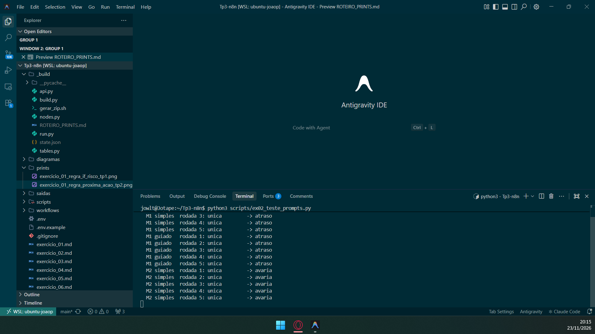
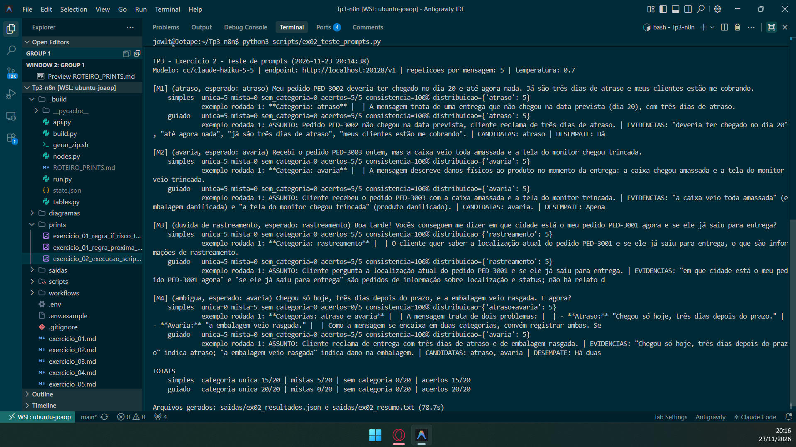

# Exercício 2 - Inferência Guiada e Consistência na Classificação de Mensagens

## 1. Contexto do Problema
O time de atendimento da Vórtice Logística recebe dezenas de mensagens diárias sobre atrasos, avarias e dúvidas de rastreamento. Uma primeira tentativa de prompt simples, formulada sem técnica de engenharia de prompt, gerou instabilidade operacional: em mensagens diretas o modelo acertava a categoria, mas em mensagens ambíguas ou com mais de um problema ele ora apenas parafraseava o texto sem definir a classe, ora misturava duas categorias na mesma resposta (por exemplo, devolvendo que o caso era ao mesmo tempo atraso e avaria). Essa oscilação quebrava a esteira automatizada nos nós seguintes.

Conforme solicitado no enunciado, este exercício não cria workflows no n8n. Ele foi implementado por meio do script de teste Python `scripts/ex02_teste_prompts.py`, que submeteu o mesmo conjunto de mensagens a repetidas rodadas sob dois prompts distintos com temperatura 0.7, permitindo avaliar a consistência probabilística real de cada abordagem.

## 2. Estrutura dos Prompts Comparados

### Prompt Simples (Tentativa Inicial do Estagiário)
* **Abordagem**: instrução direta em uma única etapa, pedindo para classificar a mensagem em uma das quatro categorias permitidas (`atraso`, `avaria`, `rastreamento` ou `outros`).
* **Texto utilizado**: "Classifique a mensagem do cliente da transportadora em uma destas categorias: atraso, avaria, rastreamento ou outros. Mensagem: {mensagem}".
* **Limitação estrutural**: não orienta a ordem de raciocínio, não define critérios de desempate quando há sobreposição de eventos e permite que o modelo decida livremente o formato e o tamanho da resposta.

### Prompt com Inferência Guiada (Solução Proposta)
* **Abordagem**: técnica de raciocínio passo a passo estruturado (Chain-of-Thought direcionado), forçando o modelo a decompor a análise em cinco etapas obrigatórias antes da decisão final:
  * **Passo 1 (Assunto)**: identificação explícita do tema da mensagem em uma frase curta, sem rotular a categoria ainda.
  * **Passo 2 (Evidências)**: extração dos trechos factuais que apontam cada problema citado pelo cliente.
  * **Passo 3 (Candidatas)**: listagem de todas as categorias potenciais que se aplicam às evidências encontradas.
  * **Passo 4 (Desempate)**: aplicação compulsória da hierarquia de criticidade operacional da Vórtice Logística (`avaria` > `atraso` > `rastreamento` > `outros`). Como o dano físico a uma mercadoria exige abertura imediata de sinistro e perícia, ele sempre prevalece sobre a demora na entrega.
  * **Passo 5 (Decisão)**: emissão da categoria final em uma única linha padronizada no formato `CATEGORIA: <categoria>`.

## 3. Resultados Empíricos dos Testes
Os testes foram executados com 5 repetições para cada uma das quatro mensagens de referência utilizando o modelo `cc/claude-haiku-5-5` com temperatura 0.7 (totalizando 40 chamadas ao LLM). Os dados brutos completos estão registrados em `saidas/ex02_resultados.json` e sintetizados em `saidas/ex02_resumo.txt`.

### Mensagem 1: Reclamação de Atraso
* Texto: "Meu pedido PED-3002 deveria ter chegado no dia 20 e até agora nada. Já são três dias de atraso e meus clientes estão me cobrando."
* Categoria esperada: `atraso`.
* Desempenho no Prompt Simples: 5 acertos em 5 rodadas (100% de consistência). A resposta veio em texto livre justificando o atraso.
* Desempenho no Prompt Guiado: 5 acertos em 5 rodadas (100% de consistência). O modelo isolou o assunto, apontou a evidência "já são três dias de atraso" e cravou `atraso`.

### Mensagem 2: Notificação de Avaria
* Texto: "Recebi o pedido PED-3003 ontem, mas a caixa veio toda amassada e a tela do monitor chegou trincada."
* Categoria esperada: `avaria`.
* Desempenho no Prompt Simples: 5 acertos em 5 rodadas (100% de consistência).
* Desempenho no Prompt Guiado: 5 acertos em 5 rodadas (100% de consistência). O modelo destacou a caixa amassada e o monitor trincado como evidências de dano físico e selecionou `avaria`.

### Mensagem 3: Dúvida de Rastreamento
* Texto: "Boa tarde! Vocês conseguem me dizer em que cidade está o meu pedido PED-3001 agora e se ele já saiu para entrega?"
* Categoria esperada: `rastreamento`.
* Desempenho no Prompt Simples: 5 acertos em 5 rodadas (100% de consistência).
* Desempenho no Prompt Guiado: 5 acertos em 5 rodadas (100% de consistência). O modelo identificou pedido de localização sem queixa de atraso e definiu `rastreamento`.

### Mensagem 4: Mensagem Ambígua (Atraso + Avaria)
* Texto: "Chegou só hoje, três dias depois do prazo, e a embalagem veio rasgada. E agora?"
* Categoria esperada: `avaria` (pela regra de prioridade de sinistro da transportadora).
* Desempenho no Prompt Simples: **0 acertos em 5 rodadas (0% de consistência para a esteira)**. Em todas as 5 rodadas o modelo devolveu respostas mistas do tipo "A mensagem se encaixa em duas categorias: atraso e avaria". Essa saída gerou `atraso+avaria`, tornando o resultado inutilizável para os nós seguintes de roteamento do n8n, que exigem uma única chave.
* Desempenho no Prompt Guiado: **5 acertos em 5 rodadas (100% de consistência)**. No Passo 1 o modelo resumiu o assunto ("entrega fora do prazo com embalagem rasgada"), no Passo 2 listou as duas evidências, no Passo 3 levantou as candidatas `avaria` e `atraso`, e no Passo 4 aplicou a regra de desempate formal: "Entre avaria e atraso, prevalece avaria por exigir abertura de sinistro". A linha final devolveu confiavelmente `CATEGORIA: avaria`.

## 4. Comparação e O Que Mudou
A comparação consolidada entre as 40 execuções revelou diferenças fundamentais:

* **Resolução de Ambiguidade**: o prompt simples falhou sistematicamente em casos com múltiplos problemas, transferindo a dúvida de volta ao chamador. A inferência guiada eliminou 100% das respostas mistas porque forneceu ao modelo o critério explícito de desempate do negócio da Vórtice Logística.
* **Isolamento Cognitivo do Assunto**: forçar o LLM a declarar primeiro o assunto da mensagem em uma frase curta funciona como uma âncora contextual. Isso impede que o modelo pule precipitadamente para conclusões baseadas em palavras isoladas antes de compreender o contexto geral da queixa.
* **Previsibilidade Sintática para Automação**: o prompt simples devolveu textos livres com formatação variada (ora parágrafos corridos, ora listas com marcadores), o que exigiria expressões regulares frágeis no n8n. O prompt guiado padronizou o formato de entrega, permitindo que a linha `CATEGORIA:` seja extraída diretamente com facilidade e segurança.

Essa validação experimental comprovou a necessidade de incorporar a inferência guiada no nó de classificação estruturada do n8n, implementado no Exercício 5.

## 5. Arquivos do Exercício
* `scripts/ex02_teste_prompts.py`: script de teste em Python.
* `saidas/ex02_resultados.json`: registro completo de todas as 40 execuções e métricas.
* `saidas/ex02_resumo.txt`: relatório sintetizado de execução.

## 6. Evidências de Execução
Execução do script no terminal, com data e hora visíveis. Essa execução repetiu o teste e chegou aos mesmos totais descritos acima (prompt simples com 15 de 20 e 5 respostas mistas na M4; prompt guiado com 20 de 20).

