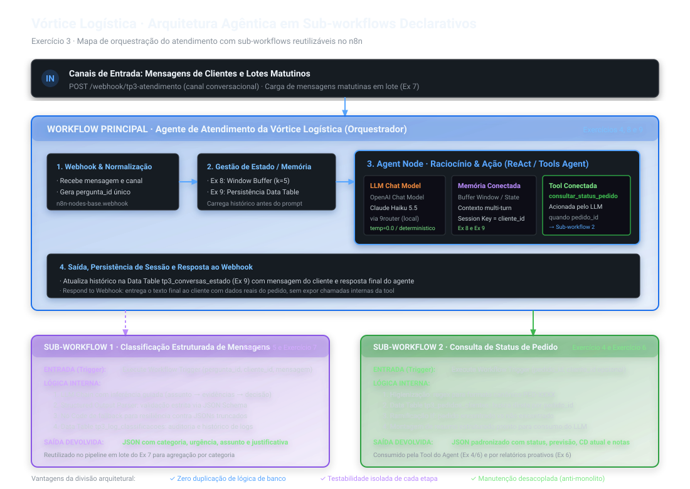
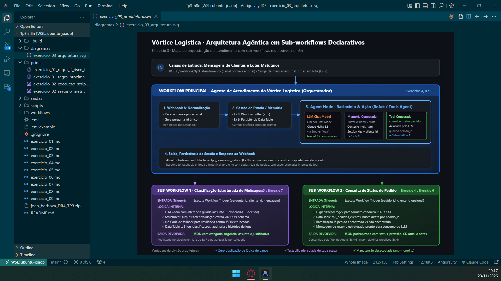

# Exercício 3 - Mapeamento da Estrutura Agêntica em Sub-workflows Declarativos

## 1. Contexto e Motivação da Arquitetura
Antes de construir o agente de atendimento no n8n, o gestor pediu um mapa da arquitetura: quais sub-workflows vão existir, o que cada um faz e como o fluxo principal vai chamá-los. O receio vem de um projeto anterior de outra área, que virou um workflow único com centenas de nós em uma só tela. Ninguém além do autor consegue entender ou dar manutenção nele hoje.

Sem esse mapa prévio, o agente de atendimento correria o risco de virar mais um monolito difícil de manter. A solução é uma **arquitetura orientada a serviços no n8n**: um fluxo principal com o Agent node e dois sub-workflows declarativos e independentes, chamados pelo nó `Execute Workflow` ou como Tool do agente.

## 2. Diagrama da Estrutura Agêntica Planejada
O diagrama completo está em `diagramas/exercicio_03_arquitetura.svg`:

Em texto, a estrutura fica assim:

* **Workflow principal: `TP3 - Agente de Atendimento (principal)`**
  * `[ENTRADA] Webhook Mensagem do Cliente`: recebe `mensagem`, `cliente_id` e `session_id`.
  * `[FUNCAO] Normalizar Mensagem`: padroniza os campos e gera o `pergunta_id`.
  * `[SUBWORKFLOW] Classificar Mensagem`: chama o Sub-workflow 1 com o nó Execute Workflow e recebe categoria e urgência.
  * `[AGENTE] Agente de Atendimento` (Agent node), com três conexões de IA:
    * Modelo: `LLM Chat Model` (OpenAI compatível).
    * Memória: janela de conversa (Exercício 8) ou estado carregado da Data Table (Exercício 9).
    * Tool: `consultar_status_pedido`, que chama o Sub-workflow 2. O agente decide sozinho quando acioná-la.
  * `[SAIDA] Responder ao Webhook`: devolve a resposta final ao cliente.
* **Sub-workflow 1: `TP3 - Sub-workflow - Classificacao Estruturada de Mensagem`** (Exercício 5)
  * `Execute Workflow Trigger`, depois `LLM Chain` com `Structured Output Parser`, depois `Code` de validação e `Data Table` de log.
* **Sub-workflow 2: `TP3 - Sub-workflow - Consulta de Status de Pedido`** (Exercício 6)
  * `Execute Workflow Trigger`, depois `Edit Fields` de higienização do código, `Data Table` de busca e `Code` que monta a resposta padronizada.
* **Outros chamadores dos mesmos sub-workflows** (prova de reutilização):
  * `TP3 - Exercicio 06 - Teste de Reutilizacao`: chama o Sub-workflow 2 fora do agente, simulando o relatório proativo.
  * `TP3 - Exercicio 07 - Pipeline em Lote`: chama o Sub-workflow 1 para cada mensagem do lote.

Relação com os exercícios seguintes:
* O **Workflow Principal** recebe a mensagem e coordena o atendimento (Exercício 4 com Tool, Exercício 7 em lote, Exercício 8 com memória de janela e Exercício 9 com persistência).
* O **Sub-workflow 1 (Classificação Estruturada)** usa uma LLM Chain com JSON Schema para devolver categoria e urgência, alimentando o log do Exercício 5 e o pipeline em lote do Exercício 7.
* O **Sub-workflow 2 (Consulta de Status de Pedido)** consulta a base de pedidos e devolve os dados em formato padrão. Ele é usado tanto como Tool do Agent node (Exercício 4 e Exercício 6) quanto por outros fluxos fora do atendimento conversacional, como relatórios proativos.

## 3. Especificação dos Sub-workflows Declarativos

### Sub-workflow 1: Classificação Estruturada de Mensagens (Exercício 5)
* **Objetivo**: transformar o texto livre do cliente em um objeto JSON tipado (categoria, nível de urgência e justificativa), rodando sem supervisão humana a qualquer hora.
* **Gatilho de entrada**: nó `Execute Workflow Trigger` no modo `passthrough`.
* **Entrada esperada**: um item com os campos:
  * `pergunta_id`: identificador único do registro (ex.: `PERG-20261123-001`).
  * `cliente_id`: código do cliente (ex.: `CLI-001`).
  * `mensagem`: texto livre enviado pelo cliente.
  * `pedido_id_sugerido`: identificador do pedido, se o cliente tiver informado (opcional).
* **Lógica interna**:
  1. O `Execute Workflow Trigger` recebe o item da chamada.
  2. Um nó `Chain LLM` recebe a mensagem e aplica o prompt de classificação (adaptado da inferência guiada do Exercício 2).
  3. O modelo `LMChatOpenAi` roda com temperatura baixa (0.0) para manter as respostas consistentes.
  4. O nó `Structured Output Parser` valida a saída contra um JSON Schema com estes campos: `assunto` (texto curto), `categoria` (uma entre `atraso`, `avaria`, `rastreamento` e `outros`), `evidencias` (lista de fatos da mensagem), `urgencia` (uma entre `baixa`, `media` e `alta`), `pedido_id_mencionado` (código do pedido ou vazio) e `justificativa` (uma frase explicando a decisão).
  5. Um nó `Code` valida se a saída tem os campos esperados com valores permitidos. Se o parser falhar ou faltar campo, marca `classificacao_valida = false` e `categoria = nao_classificado`, para o fluxo principal mandar o caso a um atendente.
  6. Um nó `Data Table` grava a classificação na tabela de log.
* **Saída devolvida ao fluxo principal**:
  * `pergunta_id`, `cliente_id`, `assunto`, `categoria`, `urgencia`, `pedido_id_mencionado`, `justificativa`, `classificacao_valida` e `processado_em`.

### Sub-workflow 2: Consulta de Status de Pedido (Exercício 6)
* **Objetivo**: buscar o status atualizado de um pedido na base corporativa da Vórtice Logística a partir de um identificador (`pedido_id`), servindo tanto como Tool para o agente quanto como serviço reutilizável para outros fluxos (como relatórios proativos de rota).
* **Gatilho de entrada**: nó `Execute Workflow Trigger` no modo `passthrough`.
* **Entrada esperada**:
  * `pedido_id`: código da encomenda (ex.: `PED-3001`). Aceita também variações de digitação (minúsculas, espaços ou sem traço).
  * `cliente_id`: código do cliente autenticado na sessão (opcional, para validação de segurança se a encomenda pertence mesmo a quem perguntou).
* **Lógica interna**:
  1. O `Execute Workflow Trigger` recebe o parâmetro de busca.
  2. Um nó `Edit Fields` higieniza o identificador, transformando formatos como `ped 3001` ou `3001` no formato canônico `PED-3001`.
  3. Um nó `Data Table` (operação `get`) busca a linha na tabela `tp3_pedidos_clientes` onde `pedido_id` é igual ao valor higienizado.
  4. Um nó `If` checa se o pedido foi encontrado:
     * Ramo Verdadeiro (encontrado): monta um objeto com `encontrado = true`, dados do cliente, produto, status (`em_transito`, `atrasado`, `entregue_com_avaria` etc.), transportadora responsável, localização atual, previsão de entrega, data da última atualização e um texto descritivo pronto para o agente usar na resposta.
     * Ramo Falso (não encontrado): monta um objeto com `encontrado = false`, o `pedido_id` pesquisado e uma mensagem orientando a conferir o código.
  5. O nó final devolve esse objeto para quem chamou.
* **Saída devolvida ao fluxo principal**:
  * Objeto JSON com `encontrado` (booleano), `pedido_id`, `status`, `produto`, `transportadora`, `localizacao_atual`, `previsao_entrega`, `ultima_atualizacao`, `observacao` e `resumo_para_cliente`.

## 4. Justificativa da Divisão em Sub-workflows
A escolha de separar essas duas lógicas em sub-workflows independentes em vez de colocar tudo em um fluxo único segue quatro razões de engenharia:

* **Reutilização em mais de um contexto**: a consulta de status de pedido não é usada só quando um cliente faz uma pergunta no chat. Como o enunciado do Exercício 6 antecipa, relatórios automáticos de despacho também precisam consultar pedidos antes de qualquer contato com o cliente. Se a lógica ficasse dentro do agente, precisaria ser copiada para o fluxo de relatórios. Qualquer mudança futura (um novo campo, uma nova transportadora) teria de ser feita em dois lugares ao mesmo tempo. Com o sub-workflow, a mesma lógica atende a ambos.
* **Testabilidade e depuração isoladas**: em um workflow monolítico, testar a classificação exige disparar a esteira inteira, do webhook à saída final. Com sub-workflows, cada peça é testada de forma independente pelo botão "Execute workflow" ou por um fluxo simples de teste, com entradas controladas. Se um problema aparecer, fica fácil saber se está na extração de dados, na classificação ou na conversa do agente.
* **Manutenibilidade e clareza visual**: um canvas com o webhook, o agente, as ferramentas, a cadeia de classificação e os nós de agregação teria mais de 30 nós misturados na mesma tela. Quem tentar dar manutenção precisa entender todos os ramos de uma vez. Com a divisão, cada canvas tem um objetivo claro: o principal orquestra, o primeiro sub-workflow classifica e o segundo consulta dados. Novos integrantes do time conseguem entender a arquitetura em poucos minutos.
* **Independência de evolução e desacoplamento**: se amanhã a Vórtice trocar a Data Table interna por um ERP ou pela API de uma transportadora parceira, só o sub-workflow de consulta precisa mudar. O Agent node, o prompt, a memória e a lógica de atendimento continuam iguais, porque o contrato de entrada e saída do sub-workflow foi mantido. O mesmo vale se o modelo de classificação for trocado por outro no futuro: a alteração fica restrita àquele nó.

## 5. Próximos Passos de Implementação
Com o mapa aprovado pelo gestor, a construção segue a ordem planejada:
1. Implementação do Agent node com a primeira tool de consulta conectada (Exercício 4).
2. Construção da LLM Chain com saída JSON estruturada e parsing validado (Exercício 5).
3. Extração da consulta de pedidos para sub-workflow e chamada reutilizável por um fluxo de teste (Exercício 6).
4. Processamento em lote com split, join e agregação (Exercício 7).
5. Adição de memória de janela (Exercício 8) e persistência de estado (Exercício 9).

## 6. Evidências de Execução
Diagrama da arquitetura aberto na tela, com data e hora visíveis.

