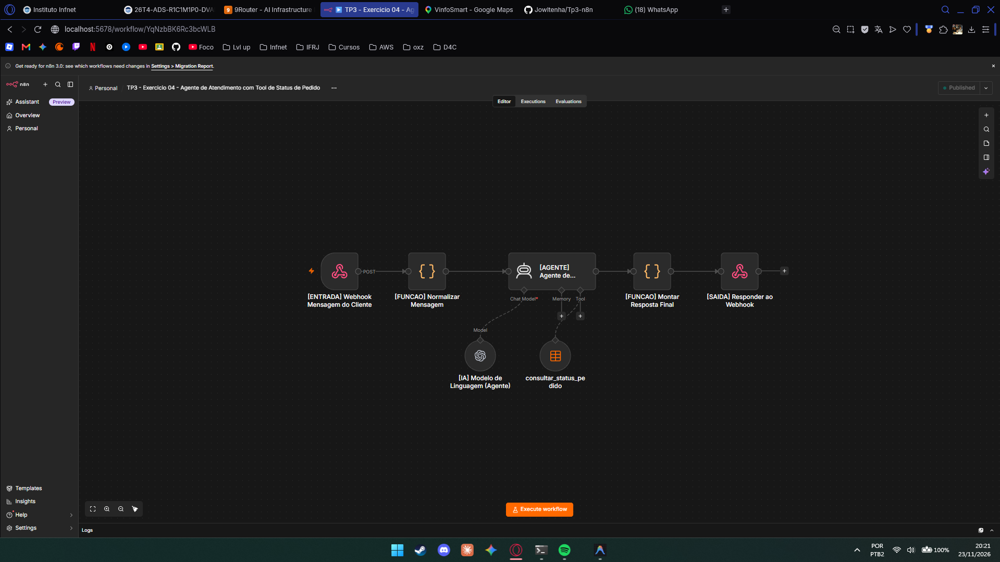
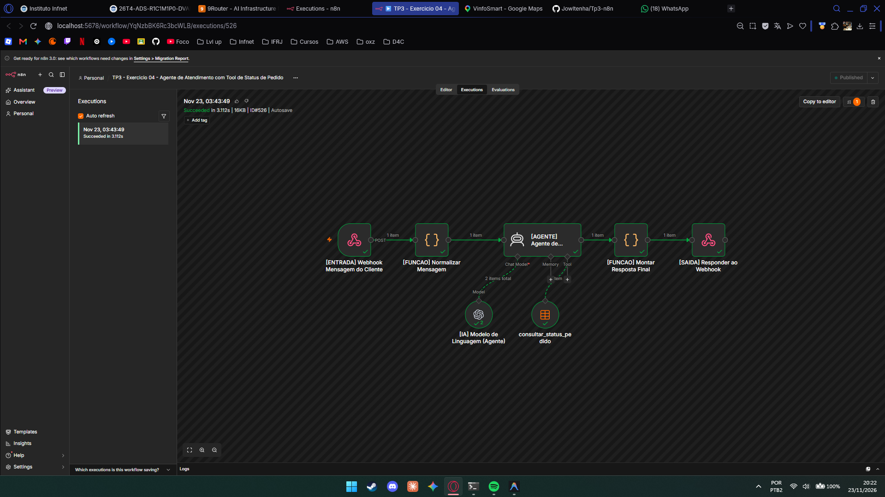
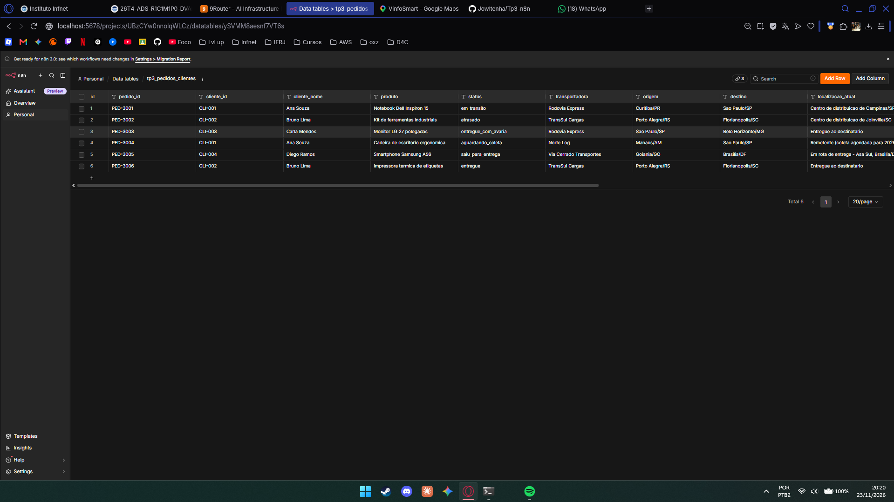

# Exercício 4 - Agent Node Conectado a uma Tool de Consulta de Pedidos

## 1. Contexto
Num teste inicial, o modelo respondeu "cadê meu pedido" com uma frase genérica, sem consultar sistema nenhum, e a equipe de atendimento ficou desconfiada da iniciativa. A primeira peça real do agente resolve isso: um Agent node ligado a um LLM e a uma tool que consulta o status do pedido antes de responder.

## 2. Data Table de Pedidos
Foi criada a Data Table `tp3_pedidos_clientes`, com seis pedidos simulados (PED-3001 a PED-3006). As colunas são `pedido_id`, `cliente_id`, `cliente_nome`, `produto`, `status`, `transportadora`, `origem`, `destino`, `localizacao_atual`, `previsao_entrega`, `ultima_atualizacao` e `observacao`. Os registros cobrem os casos que o atendimento mais recebe:

* PED-3001: em trânsito, dentro do prazo (CD de Campinas/SP, previsão 24/11).
* PED-3002: atrasado (previsão original 20/11, nova previsão 25/11, retido no CD de Joinville/SC).
* PED-3003: entregue com avaria (tela trincada, sinistro SIN-0778 aberto).
* PED-3004: aguardando coleta.
* PED-3005: saiu para entrega.
* PED-3006: entregue.

## 3. Workflow
O workflow `TP3 - Exercicio 04 - Agente de Atendimento com Tool de Status de Pedido` tem os nós:

* `[ENTRADA] Webhook Mensagem do Cliente`: `POST /webhook/tp3-ex04-atendimento`, com `mensagem`, `cliente_id` e `session_id`.
* `[FUNCAO] Normalizar Mensagem`: gera o `pergunta_id` e padroniza os campos.
* `[AGENTE] Agente de Atendimento` (AI Agent, Tools Agent), com duas conexões de IA:
  * Modelo: `[IA] Modelo de Linguagem (Agente)`, OpenAI Chat Model com o modelo `cc/claude-haiku-5-5` e temperatura 0.
  * Tool: `consultar_status_pedido`, um nó Data Table usado como ferramenta (operação Get na tabela `tp3_pedidos_clientes`, filtro `pedido_id` igual a um valor preenchido pelo próprio LLM via `$fromAI`). A descrição da tool diz ao modelo quando usá-la e qual o formato do código.
  * System message: obriga o agente a chamar a tool antes de responder sobre qualquer pedido, proíbe inventar status ou datas e manda pedir o código quando o cliente não informar.
  * A opção Return Intermediate Steps está ligada, para registrar quais ferramentas o agente acionou.
* `[FUNCAO] Montar Resposta Final`: junta a resposta do agente com a lista de ferramentas acionadas (`agente_usou_ferramenta` e `ferramentas_acionadas`).
* `[SAIDA] Responder ao Webhook`: devolve o JSON final.

O workflow não tem nenhum If que decida chamar a consulta. Quem decide é o modelo, a partir da mensagem e da descrição da tool. Essa é a diferença em relação ao TP2, onde o fluxo chamava o agente sempre, na mesma ordem.

## 4. Teste
Mensagem enviada ao webhook de produção (execução 526): "Oi, onde esta meu pedido PED-3001?". A mensagem não diz o que fazer com o código: a decisão de consultar a base fica com o agente.

O que a execução mostra, nó a nó, no painel de execuções:

* `[AGENTE] Agente de Atendimento`: na primeira iteração, o modelo não respondeu ao cliente. Ele emitiu uma chamada à tool `consultar_status_pedido` com a entrada `{"pedido_id": "PED-3001"}`, valor que ele mesmo extraiu da frase.
* `consultar_status_pedido`: a busca na Data Table devolveu a linha do PED-3001 (Notebook Dell Inspiron 15, `em_transito`, Rodovia Express, Centro de distribuição de Campinas/SP, previsão 2026-11-24, última atualização 2026-11-22 18:40).
* Segunda iteração do agente: com o resultado da tool em mãos, o modelo escreveu a resposta final: "Olá! O pedido PED-3001 (Notebook Dell Inspiron 15) está em trânsito. Ele está atualmente no Centro de Distribuição de Campinas/SP, a caminho de São Paulo/SP, transportado pela Rodovia Express. A previsão de entrega é para 24/11/2026, e a carga está dentro do prazo. A última atualização foi em 22/11/2026, às 18:40."
* `[FUNCAO] Montar Resposta Final`: `agente_usou_ferramenta: true` e `ferramentas_acionadas` com a chamada acima, lidas dos intermediate steps do agente.

Todos os dados da resposta (produto, local, transportadora, data e hora) existem só na Data Table. Nenhum deles está no prompt nem na mensagem do cliente. Isso confirma que o agente acionou a tool antes de responder, e não respondeu só com base no prompt.

Comportamento observado nos testes seguintes com o mesmo agente (Exercício 5): quando o cliente não informa o código do pedido, o agente não chama a tool e pede o código, como manda a regra 2 do system message. Ou seja, o uso da ferramenta é uma decisão do modelo a cada mensagem, e não uma etapa fixa do fluxo.

## 5. Arquivos
* `workflows/workflow_exercicio_04.json`

## 6. Evidências de Execução
Capturas em tela cheia, com data e hora visíveis.

