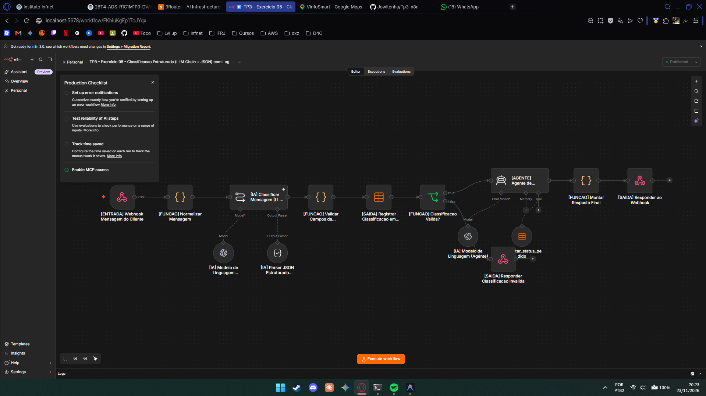
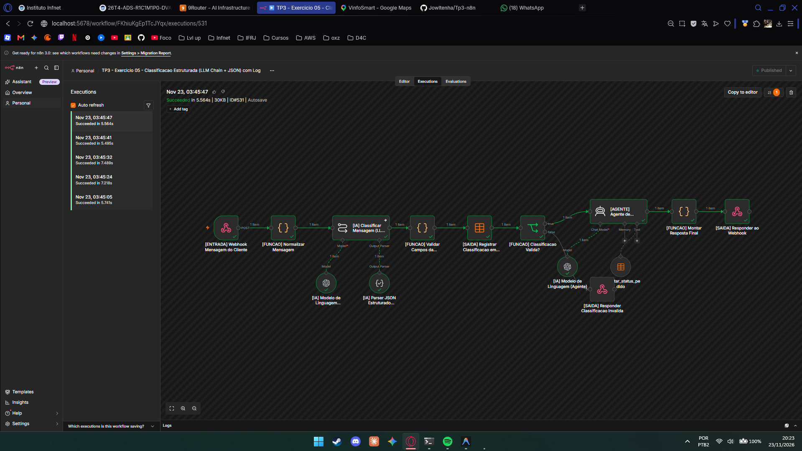

# Exercício 5 - LLM Chain com Parsing de Saída JSON Estruturada e Log

## 1. Contexto
No Exercício 2, a classificação das mensagens funcionava com alguém lendo a resposta do modelo. Agora ela precisa rodar de forma automática dentro do fluxo, inclusive de madrugada, sem ninguém conferindo. Isso exige que a saída venha em JSON estruturado, para que os nós seguintes consumam os campos diretamente, sem depender de expressões para tentar adivinhar a categoria no meio de um texto livre.

Além de classificar e responder, o workflow precisa registrar cada classificação em log (arquivo JSON ou Data Table).

## 2. LLM Chain e Structured Output Parser
O workflow usa o nó Basic LLM Chain conectado a:

* Modelo: OpenAI Chat Model (`cc/claude-haiku-5-5`, temperatura 0).
* Parser: nó Structured Output Parser com JSON Schema manual (`schemaType = manual`), exigindo os campos:
  * `assunto`: resumo curto do que a mensagem trata.
  * `evidencias`: lista de fatos tirados da mensagem que sustentam a decisão.
  * `categoria`: uma entre `atraso`, `avaria`, `rastreamento` e `outros`.
  * `urgencia`: uma entre `baixa`, `media` e `alta`.
  * `pedido_id_mencionado`: código PED-0000 citado, ou string vazia.
  * `justificativa`: explicação da classificação.
* Prompt do sistema: usa a inferência guiada do Exercício 2 (assunto, evidências, candidatas, regra de desempate priorizando avaria sobre atraso e decisão final).

## 3. Parsing, Validação e Registro em Log
A cadeia do workflow tem os seguintes nós:

* `[ENTRADA] Webhook Mensagem do Cliente`: `POST /webhook/tp3-ex05-atendimento`.
* `[FUNCAO] Normalizar Mensagem`: gera o `pergunta_id`.
* `[IA] Classificar Mensagem (LLM Chain)` com o modelo e o Structured Output Parser.
* `[FUNCAO] Validar Campos da Classificacao` (Code): confere se o parser entregou todos os campos obrigatórios, se a categoria é uma das quatro permitidas e se a urgência é válida. Se algum campo faltar, marca `classificacao_valida = false` e preenche `campos_faltando`.
* `[SAIDA] Registrar Classificacao em tp3_log_classificacoes`: grava cada pergunta com a categoria, urgência, justificativa e flag de validade na Data Table `tp3_log_classificacoes`.
* `[FUNCAO] Classificacao Valida?` (If):
  * Ramo verdadeiro: chama o `[AGENTE] Agente de Atendimento` (o mesmo do Exercício 4, com a tool de pedidos), passando a mensagem do cliente junto com a categoria e a urgência já identificadas. O agente responde com os dados do pedido e o webhook devolve a resposta completa ao cliente.
  * Ramo falso: devolve HTTP 202 com a mensagem "Recebemos sua mensagem. Um atendente vai analisar seu caso", sem quebrar o fluxo.

## 4. Testes com as Quatro Mensagens do Exercício 2
As mesmas quatro mensagens do Exercício 2 foram enviadas ao webhook de produção, uma por execução (execuções 528 a 531). A tabela mostra a saída estruturada que chegou ao nó `[FUNCAO] Validar Campos da Classificacao` e foi gravada no log:

| Mensagem | Esperado (Ex02) | categoria | urgencia | pedido_id_mencionado | classificacao_valida |
|----------|-----------------|-----------|----------|----------------------|----------------------|
| M1 - atraso | atraso | atraso | alta | PED-3002 | true |
| M2 - avaria | avaria | avaria | alta | PED-3003 | true |
| M3 - rastreamento | rastreamento | rastreamento | baixa | PED-3001 | true |
| M4 - ambígua | avaria | avaria | alta | (vazio) | true |

Pontos observados:

* **Consistência com o Exercício 2**: as quatro categorias são iguais às do prompt guiado no Exercício 2 (que acertou 20 de 20 rodadas). Na M4, a ambígua, a justificativa gravada foi "Há dois problemas, mas a avaria tem prioridade sobre o atraso por exigir abertura de sinistro", a mesma regra de desempate do Exercício 2.
* **Campos chegando aos nós seguintes**: o If `Classificacao Valida?` e o agente leem `$json.categoria` e `$json.urgencia` diretamente, sem procurar texto. Em todas as quatro execuções o If seguiu pelo ramo verdadeiro.
* **Urgência**: o modelo seguiu a regra definida no prompt (alta para avaria e atraso com cliente insatisfeito, baixa para rastreamento).
* **Uso da tool depois da classificação**: nas mensagens M1, M2 e M3 o agente consultou o pedido e respondeu com os dados reais (por exemplo, na M2 citou o sinistro SIN-0778 já aberto). Na M4, que não tem código de pedido (`pedido_id_mencionado` vazio), o agente não chamou a tool e pediu o código PED-0000 ao cliente.
* **Log**: cada execução gravou uma linha na Data Table `tp3_log_classificacoes`, com `exercicio = ex05`.

Diferença em relação ao Exercício 2: lá a categoria vinha numa linha `CATEGORIA:` dentro de um texto e precisava ser extraída por expressão regular no script. Aqui o Structured Output Parser recusa qualquer saída que não siga o schema (campo faltando ou categoria fora do enum), e o nó de validação ainda confere os valores antes de seguir. Se o modelo devolver algo fora do formato, o item vai para o ramo de classificação inválida em vez de seguir com um valor errado.

## 5. Arquivos
* `workflows/workflow_exercicio_05.json`
* `saidas/ex05_teste_quatro_mensagens.json`: respostas completas das quatro execuções.

## 6. Evidências de Execução
Capturas em tela cheia, com data e hora visíveis.

