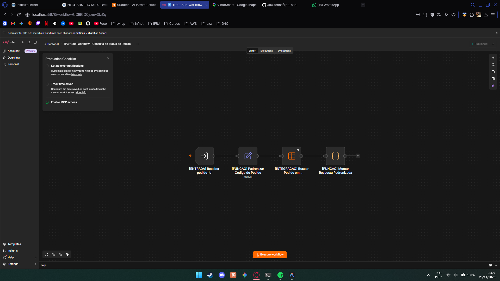
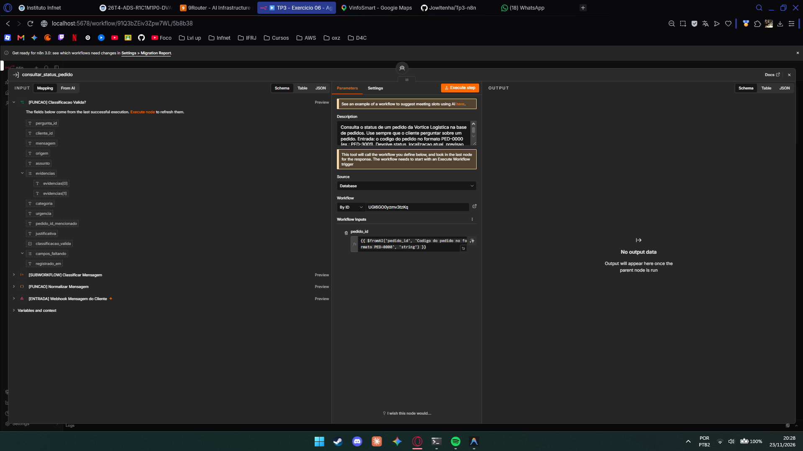
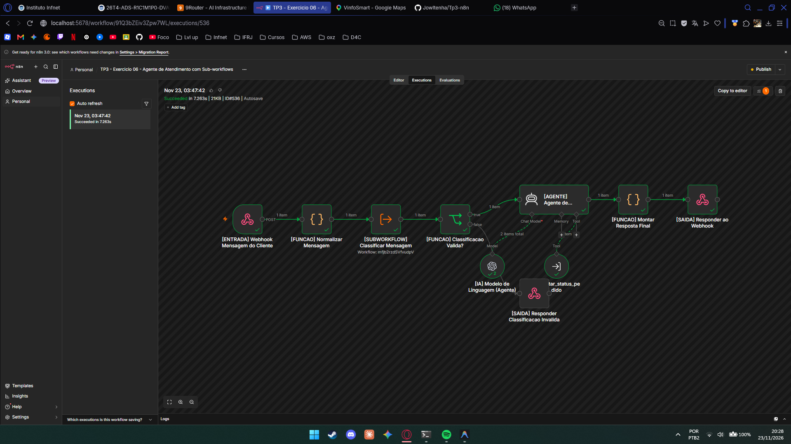

# Exercício 6 - Sub-workflow Chamável Reutilizável de Consulta de Pedidos

## 1. Contexto
A consulta de pedidos, usada pela tool do Exercício 4, também é necessária em outro ponto da operação da Vórtice Logística: em um relatório automático enviado proativamente ao cliente antes mesmo de ele entrar em contato com o atendimento. Se essa lógica fosse duplicada nos dois lugares, qualquer alteração futura (uma nova transportadora parceira, um novo campo de status) exigiria alterar dois workflows ao mesmo tempo, correndo o risco de ficarem fora de sintonia.

A solução foi extrair a lógica para um sub-workflow independente, chamado tanto pelo agente quanto pelo relatório proativo.

## 2. Sub-workflows Criados
Foram criados dois sub-workflows independentes:

* `TP3 - Sub-workflow - Consulta de Status de Pedido`:
  * Entrada: `[ENTRADA] Receber pedido_id` (Execute Workflow Trigger declarando o campo `pedido_id`).
  * `[FUNCAO] Padronizar Codigo do Pedido`: higieniza o código para o formato `PED-0000`.
  * `[INTEGRACAO] Buscar Pedido em tp3_pedidos_clientes`: busca na Data Table por `pedido_id`.
  * `[FUNCAO] Montar Resposta Padronizada`: se o pedido existir, devolve `encontrado: true` com status, transportadora, localização atual, previsão de entrega e observação. Se não existir, devolve `encontrado: false` com mensagem orientando a conferir o código.
  * Esse é o contrato único de saída, usado em qualquer contexto.
* `TP3 - Sub-workflow - Classificacao Estruturada de Mensagem`:
  * Extrai a lógica do Exercício 5 (LLM Chain + Structured Output Parser + validação + gravação em log) para outro sub-workflow chamável, usado pelo agente no Exercício 6 e pelo pipeline em lote no Exercício 7.

## 3. Workflows que Chamam o Sub-workflow de Pedidos
A reutilização foi comprovada por dois caminhos:

* **Contexto 1 - Agente de atendimento** (`TP3 - Exercicio 06 - Agente de Atendimento com Sub-workflows`):
  * O Agent node agora usa a tool `consultar_status_pedido` configurada como **Call n8n Workflow Tool** (v2.2), apontando para o sub-workflow `TP3 - Sub-workflow - Consulta de Status de Pedido`.
  * O LLM preenche o parâmetro `pedido_id` via `$fromAI`, a tool chama o sub-workflow, recebe os dados padronizados e os entrega ao modelo para formular a resposta ao cliente.
* **Contexto 2 - Relatório proativo** (`TP3 - Exercicio 06 - Teste de Reutilizacao (Relatorio Proativo de Pedido)`):
  * Um novo workflow de teste, acionado por webhook (`POST /webhook/tp3-ex06-relatorio-proativo`), recebe uma lista de pedidos e chama o mesmo sub-workflow usando o nó **Execute Workflow** (com `mode = each`), sem passar por nenhum agente de IA.
  * O nó `[FUNCAO] Montar Relatorio Proativo` monta a mensagem que será enviada aos clientes antes de qualquer contato humano ("Olá, Bruno! Seu pedido PED-3002 está com status atrasado...").

A mesma lógica atende a ambos os contextos. Qualquer melhoria futura na busca de pedidos passa a valer automaticamente para o agente e para o relatório.

## 4. Testes
A reutilização foi testada nos dois contextos:

### Contexto 1: Agente de Atendimento (execução 536)
Mensagem enviada pelo cliente CLI-003: "Meu monitor do pedido PED-3003 chegou com a tela trincada. O que vocês vão fazer?". O que aconteceu na execução:

1. O sub-workflow `sub_classificacao` classificou a mensagem como `categoria: avaria`, `urgencia: alta` e assunto "Cliente informa que o monitor do pedido PED-3003 chegou com a tela trincada e pergunta as providências".
2. O Agent node recebeu a mensagem com a classificação e decidiu chamar a tool `consultar_status_pedido`.
3. A tool chamou o sub-workflow `sub_pedidos` com `pedido_id: "PED-3003"`.
4. O sub-workflow buscou na Data Table `tp3_pedidos_clientes` e devolveu o JSON padronizado com `encontrado: true`, produto "Monitor LG 27 polegadas", status `entregue_com_avaria`, transportadora Rodovia Express e observação "Cliente relatou tela trincada. Sinistro SIN-0778 aberto".
5. O agente formulou a resposta citando os dados reais: "Lamento pelo problema, Carla. Registramos a avaria no pedido PED-3003 (monitor LG 27 polegadas, entregue em 21/11/2026 pela Rodovia Express) e o caso já está com a equipe de sinistros sob o número SIN-0778. Use esse número para acompanhar o atendimento."
6. O retorno registrou a ferramenta acionada e o parâmetro passado, confirmando a chamada ao sub-workflow.

### Contexto 2: Relatório Proativo de Rota (execução 532)
Disparo no endpoint `POST /webhook/tp3-ex06-relatorio-proativo` com três pedidos: `PED-3002`, `PED-3005` e `PED-9999` (inexistente). O que aconteceu na execução:

1. O nó `[FUNCAO] Listar Pedidos do Relatorio` gerou três itens.
2. O nó `[SUBWORKFLOW] Consultar Status do Pedido` (Execute Workflow, `mode = each`) chamou o mesmo sub-workflow `sub_pedidos` três vezes.
3. Para `PED-3002`, o sub-workflow devolveu `encontrado: true` com status `atrasado`, cliente Bruno Lima e localização no CD de Joinville/SC. O nó montou o aviso ao cliente: "Olá, Bruno Lima! Seu pedido PED-3002 (Kit de ferramentas industriais) está com status atrasado. Local atual: Centro de distribuição de Joinville/SC. Previsão de entrega: 2026-11-25."
4. Para `PED-3005`, devolveu `encontrado: true` com status `saiu_para_entrega`, cliente Diego Ramos e aviso informando rota em Brasília/DF com previsão para hoje.
5. Para `PED-9999`, o sub-workflow devolveu `encontrado: false` e `aviso_ao_cliente: null`.
6. O relatório consolidado devolveu `total: 3` com a lista dos três pedidos formatados para envio ao cliente.

O teste comprova que o mesmo sub-workflow `sub_pedidos` atende a dois chamadores com propósitos completamente diferentes: o agente conversacional de atendimento (que o chama via Call n8n Workflow Tool) e o sistema de disparo proativo em lote (que o chama via Execute Workflow). Qualquer melhoria na consulta de pedidos (uma nova tabela, uma API externa de transportadora) é feita uma única vez e beneficia ambos os fluxos.

## 5. Arquivos
* `workflows/sub_pedidos.json`
* `workflows/sub_classificacao.json`
* `workflows/workflow_exercicio_06.json`
* `workflows/workflow_exercicio_06_teste.json`

## 6. Evidências de Execução
Capturas em tela cheia, com data e hora visíveis.

