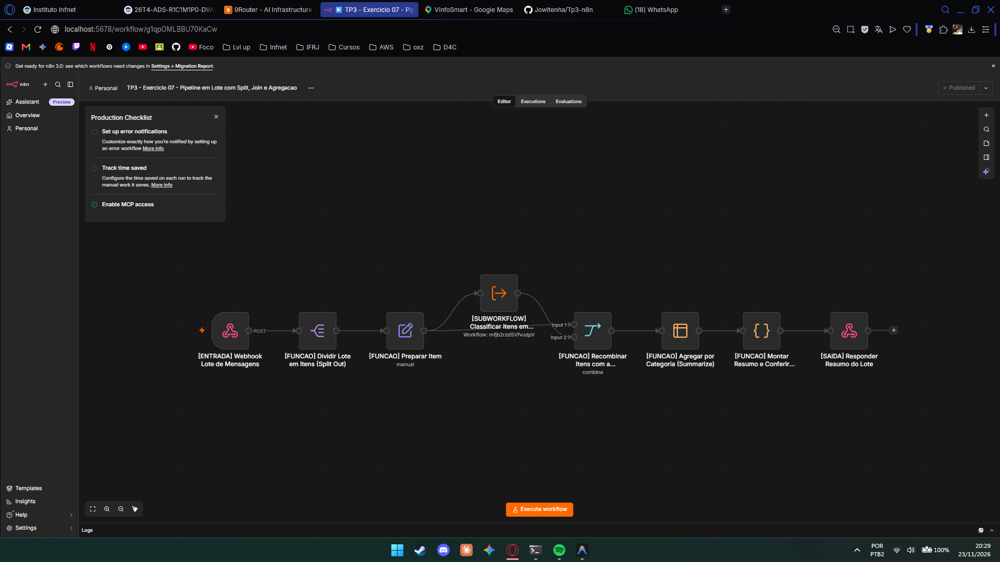
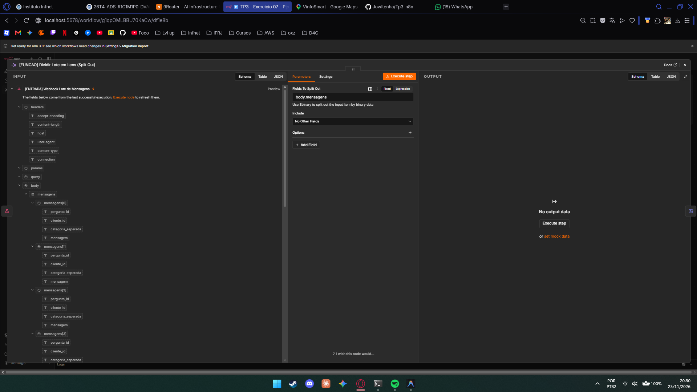

# Exercício 7 - Pipeline em Lote com Split, Join e Agregação por Categoria

## 1. Contexto
Todo início de dia, o time de atendimento recebe um arquivo com dezenas de mensagens acumuladas durante a madrugada. Processar uma por vez, esperando o LLM responder cada uma antes de passar para a próxima, deixaria a rodada da manhã lenta demais num dia de pico. Além da velocidade, a equipe quer um resumo final com quantas mensagens caíram em cada categoria, para decidir onde concentrar a atenção humana naquele dia.

## 2. Estrutura do Pipeline
O workflow `TP3 - Exercicio 07 - Pipeline em Lote com Split, Join e Agregacao` reaproveita o sub-workflow de classificação criado no Exercício 6, sem copiar a lógica:

* `[ENTRADA] Webhook Lote de Mensagens`: `POST /webhook/tp3-ex07-lote`, recebendo o lote no campo `mensagens` (cada item com `pergunta_id`, `cliente_id`, `mensagem` e `categoria_esperada`, esta última usada só na conferência).
* **Split**: `[FUNCAO] Dividir Lote em Itens (Split Out)` transforma o array em um item do n8n por mensagem.
* `[FUNCAO] Preparar Item` (Edit Fields): padroniza os campos de cada item e marca a origem `ex07`.
* **Processamento individual**: `[SUBWORKFLOW] Classificar Itens em Paralelo` (Execute Workflow) envia todos os itens numa única chamada ao `TP3 - Sub-workflow - Classificacao Estruturada de Mensagem`. Dentro do sub-workflow, a LLM Chain está com Batch Processing (`batchSize = 4`): cada item continua tendo a sua própria chamada ao LLM e o seu próprio JSON, mas as chamadas saem em grupos de quatro ao mesmo tempo, em vez de uma depois da outra. A Chain também está com On Error = continuar, para que uma falha de parsing em uma mensagem não derrube o lote inteiro (o item volta marcado como `nao_classificado`).
* **Join**: `[FUNCAO] Recombinar Itens com a Classificacao (Merge)`, em modo Combine por `pergunta_id` (Enrich Input 1). O Input 1 é o item original e o Input 2 é a classificação devolvida pelo sub-workflow. O casamento pela chave, e não pela posição, garante que cada classificação volte para a mensagem certa mesmo com o processamento em paralelo.
* **Agregação**: `[FUNCAO] Agregar por Categoria (Summarize)` agrupa pelo campo `categoria` e conta os itens (`count` de `pergunta_id`), produzindo uma linha por categoria.
* `[FUNCAO] Montar Resumo e Conferir Contagem` (Code): monta o resumo final (`total_por_categoria`) e compara com a contagem manual feita a partir de `categoria_esperada`, devolvendo `resumo_bate_com_contagem_manual`.
* `[SAIDA] Responder Resumo do Lote`: devolve o resumo ao chamador.

## 3. Lote de Teste
Lote de 10 mensagens variadas, com a categoria esperada definida manualmente antes do teste:

| ID | Mensagem | Categoria esperada |
|----|----------|--------------------|
| L01 | O pedido PED-3002 era para o dia 20 e ainda não chegou. Preciso de uma posição urgente. | atraso |
| L02 | O monitor do pedido PED-3003 chegou com a tela trincada. | avaria |
| L03 | Onde está o meu pedido PED-3001 agora? | rastreamento |
| L04 | Meu celular já saiu para entrega? Pedido PED-3005. | rastreamento |
| L05 | Faz uma semana que espero a entrega e ninguém me dá retorno. Isso é um absurdo. | atraso |
| L06 | A caixa chegou molhada e dois itens vieram quebrados. | avaria |
| L07 | Gostaria de atualizar o endereço de cobrança do meu cadastro. | outros |
| L08 | Qual a previsão de coleta do pedido PED-3004? | rastreamento |
| L09 | Chegou com dois dias de atraso e com a embalagem violada. | avaria |
| L10 | Parabéns pelo atendimento de ontem, o motorista foi muito educado. | outros |

Contagem manual esperada: atraso 2, avaria 3, rastreamento 3, outros 2 (total 10).

## 4. Resultado
Execução 539, status `success`. O lote de 10 mensagens foi processado de ponta a ponta em 12,9 segundos (medidos do envio do POST até a resposta), incluindo 10 chamadas ao LLM. Com as chamadas saindo em grupos de quatro, o tempo ficou próximo de três rodadas de chamada, e não de dez em sequência.

Resumo agregado devolvido pelo pipeline (`total_por_categoria`):

| Categoria | Obtido pelo pipeline | Contagem manual | Confere |
|-----------|----------------------|-----------------|---------|
| atraso | 2 | 2 | sim |
| avaria | 3 | 3 | sim |
| rastreamento | 3 | 3 | sim |
| outros | 2 | 2 | sim |
| **Total** | **10** | **10** | **sim** |

O campo `resumo_bate_com_contagem_manual` veio `true`. Item a item, as 10 classificações bateram com a categoria esperada, inclusive a L09 ("Chegou com dois dias de atraso e com a embalagem violada"), que tem atraso e avaria e foi classificada como `avaria` pela regra de desempate.

Urgência: as cinco mensagens de atraso e avaria vieram com `alta`, e as cinco de rastreamento e outros com `baixa`. Para a equipe, o resumo indica que metade do lote da manhã exige ação prioritária (2 atrasos e 3 avarias, com abertura de sinistro), enquanto o rastreamento pode ser respondido pelo próprio agente com a tool de pedidos.

Cada mensagem também foi gravada na Data Table `tp3_log_classificacoes` com `exercicio = ex07`, pelo mesmo nó de log do sub-workflow usado no Exercício 6.

## 5. Arquivos
* `workflows/workflow_exercicio_07.json`
* `saidas/ex07_resumo_lote.json`: resposta completa do pipeline.

## 6. Evidências de Execução
Capturas em tela cheia, com data e hora visíveis.

