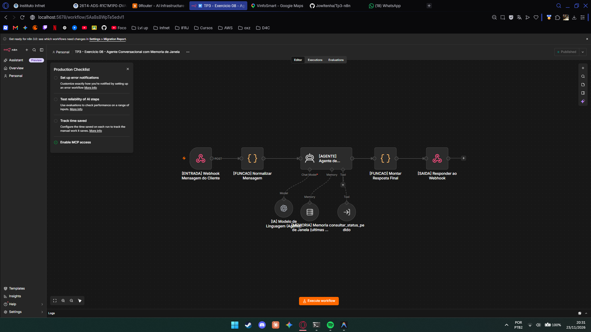
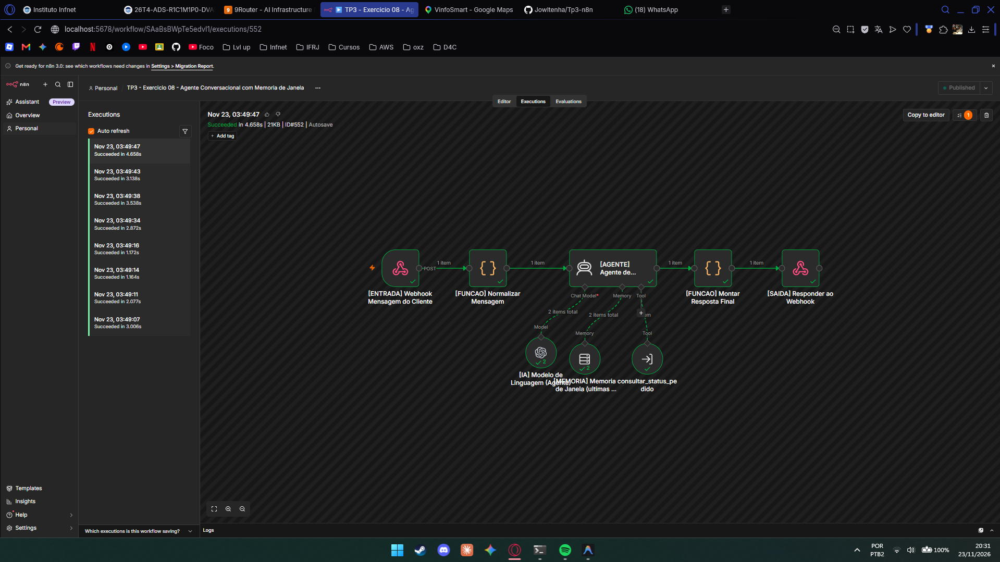

# Exercício 8 - Memória de Janela no Agente Conversacional

## 1. Contexto
Alguns clientes trocam várias mensagens seguidas sobre o mesmo caso. Sem memória, o agente do Exercício 4 trata cada mensagem como a primeira da conversa e obriga o cliente a repetir o que já disse minutos antes, o que gera reclamações de atendimento "robótico".

## 2. Workflow
O workflow `TP3 - Exercicio 08 - Agente Conversacional com Memoria de Janela` recebe uma mensagem por vez e devolve a resposta final ao webhook:

* `[ENTRADA] Webhook Mensagem do Cliente`: `POST /webhook/tp3-ex08-conversa`, com `mensagem`, `cliente_id` e `session_id`.
* `[FUNCAO] Normalizar Mensagem`: padroniza os campos. O `session_id` identifica a conversa.
* `[AGENTE] Agente de Atendimento` (AI Agent), com três conexões de IA:
  * Modelo: OpenAI Chat Model (`cc/claude-haiku-5-5`, temperatura 0).
  * Memória: `[MEMORIA] Memoria de Janela (ultimas 5 trocas)`, nó Simple Memory (Window Buffer Memory) com Session Key `{{ $json.session_id }}` e Context Window Length = 5. O nó guarda as últimas 5 trocas (pergunta do cliente e resposta do agente) de cada sessão e as injeta no prompt do modelo a cada nova mensagem.
  * Tool: `consultar_status_pedido`, chamando o sub-workflow de consulta de pedidos do Exercício 6 (a lógica não foi copiada). Os pedidos continuam na Data Table `tp3_pedidos_clientes`.
  * System message: além das regras do Exercício 4, orienta o agente a usar o que o cliente já informou (nome, código do pedido, problema) e não pedir de novo.
* `[FUNCAO] Montar Resposta Final` e `[SAIDA] Responder ao Webhook`: devolvem a resposta e as ferramentas acionadas.

## 3. Conversa Simulada
Conversa de quatro mensagens na mesma sessão. Só a primeira mensagem cita o nome e o código do pedido:

1. "Oi, meu nome é Bruno e tenho uma dúvida sobre o meu pedido PED-3002."
2. "Ele já deveria ter chegado. Qual é a nova previsão de entrega?"
3. "E qual transportadora está com ele e por que atrasou?"
4. "Obrigado. Só para confirmar: qual é mesmo o número do meu pedido e qual o meu nome?"

Resultado com a janela de 5 trocas (sessão `ex08-bruno-1795416547`, execuções 541, 543, 544 e 545):

| Turno | Mensagem do cliente | O que o agente fez | Tool acionada? |
|-------|---------------------|--------------------|----------------|
| 1 | Nome Bruno e pedido PED-3002 | Consultou o pedido e informou o atraso, o motivo e a nova previsão (25/11/2026). | sim (PED-3002) |
| 2 | "Ele já deveria ter chegado. Qual é a nova previsão?" | Entendeu que "ele" é o PED-3002, chamou o cliente de Bruno e repetiu a previsão de 25/11/2026 com o motivo. | não |
| 3 | "E qual transportadora está com ele e por que atrasou?" | Respondeu TransSul Cargas e retenção por excesso de volume no CD de Joinville/SC. | não |
| 4 | "Qual é mesmo o número do meu pedido e qual o meu nome?" | "O número do seu pedido é PED-3002 e o nome cadastrado é Bruno Lima." | não |

O que comprova o uso da memória:

* O cliente só citou o nome e o código do pedido na mensagem 1. Nas mensagens 2, 3 e 4 ele usou "ele" ou perguntou diretamente pelos dados, e o agente nunca pediu o código de novo.
* Nos turnos 2, 3 e 4 o agente não chamou a tool: tudo o que ele respondeu (previsão, transportadora, motivo, nome e código) veio do histórico injetado pela memória, que incluía o resultado da consulta feita no turno 1.
* O nó de memória aparece em cada execução com as mensagens anteriores da mesma sessão carregadas antes da chamada ao modelo.

## 4. O que Aconteceria com uma Janela Menor que o Necessário
A Window Buffer Memory não resume nem escolhe o que é importante: ela guarda as últimas K trocas e descarta as mais antigas. Se K for menor do que a distância entre a mensagem que trouxe a informação e a mensagem que precisa dela, essa informação some do prompt do modelo.

No cenário testado, o nome e o código do pedido aparecem só na mensagem 1, e a mensagem 4 pergunta exatamente por eles, três trocas depois. Para o agente lembrar sem consultar nada de novo, a janela precisa de pelo menos 3 trocas. Com 5 há folga.

Para ver o efeito na prática, o mesmo workflow foi republicado com Context Window Length = 1 e a mesma conversa foi repetida numa sessão nova (`ex08-janela1-1795416574`, execuções 546 a 552). O agente passou a chamar a tool `consultar_status_pedido` nos quatro turnos, em vez de só no primeiro. Ele só conseguiu continuar porque a resposta imediatamente anterior (a única que ainda estava na janela) sempre repetia o código PED-3002, e o modelo reaproveitou esse código para consultar a base outra vez.

Consequências de uma janela pequena demais, observadas e previstas:

* **Mais chamadas à base e ao modelo**: cada pergunta de continuação vira uma nova consulta, porque o resultado das consultas anteriores saiu da memória. No teste, foram 4 chamadas à tool em vez de 1.
* **Continuidade frágil**: a conversa só se manteve porque o agente repetia o código do pedido em toda resposta. Se a resposta anterior não citasse o código (por exemplo, um "Posso ajudar em algo mais?"), o turno seguinte com "e por que atrasou?" ficaria sem referência, e o agente teria de pedir o código de novo, exatamente a reclamação de atendimento "robótico" que motivou o exercício.
* **Perda de informação que não está na base**: o que só o cliente disse (por exemplo, "o produto é para um evento na sexta", ou um problema relatado no começo da conversa) não volta por consulta nenhuma. Quando sai da janela, se perde.
* **Respostas contraditórias**: sem o histórico, o agente pode repetir perguntas já respondidas ou dar uma orientação diferente da que deu dois turnos antes.

Por outro lado, uma janela grande demais aumenta o tamanho do prompt (e o custo) em toda mensagem. O tamanho da janela deve cobrir a distância típica entre o momento em que o cliente informa algo e o momento em que essa informação volta a ser necessária. Depois do teste, o workflow foi restaurado para 5 trocas.

## 5. Arquivos
* `workflows/workflow_exercicio_08.json`
* `saidas/ex08_conversa_janela5.json` e `saidas/ex08_conversa_janela1.json`

## 6. Evidências de Execução
Capturas em tela cheia, com data e hora visíveis.

