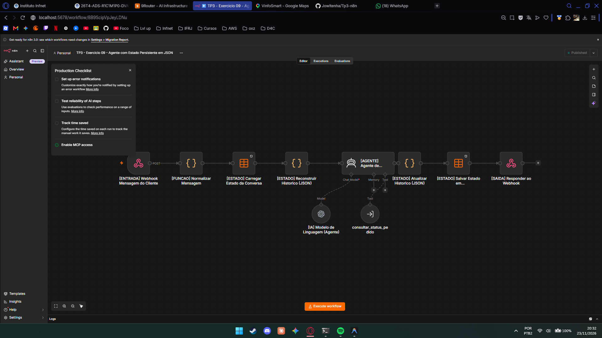
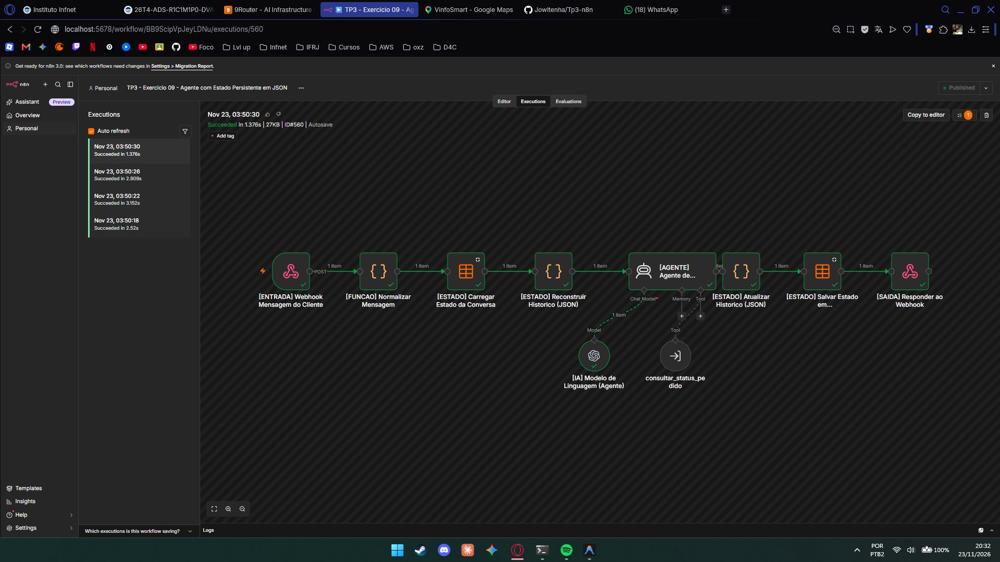

# Exercício 9 - Estado Persistente da Conversa em JSON entre Execuções

## 1. Contexto
A memória de janela do Exercício 8 fica na memória do processo do n8n. Ela funciona com poucos usuários e uma única instância, mas não se sustenta quando o fluxo escala: com vários servidores n8n atrás de um balanceador (queue mode), a segunda mensagem de um cliente pode cair num worker diferente do que atendeu a primeira, e esse worker não tem o histórico. Um reinício do n8n também apaga tudo.

A solução é tirar o estado da memória do processo e gravá-lo num armazenamento compartilhado, carregando-o no início de cada execução.

## 2. Onde e Como o Estado é Gravado
O estado fica na Data Table `tp3_conversas_estado`, no banco do n8n, que é compartilhado por todas as instâncias. Há uma linha por conversa:

* `session_id`: chave da conversa.
* `cliente_id`.
* `historico_json`: o histórico da conversa serializado em JSON, uma lista de trocas no formato {cliente, agente, em, execucao}. Ficam guardadas as últimas 10 trocas.
* `contexto_json`: contexto extraído da conversa, também em JSON (pedidos citados e última execução).
* `total_mensagens`, `criado_em` e `atualizado_em`.

## 3. Workflow
O workflow `TP3 - Exercicio 09 - Agente com Estado Persistente em JSON` parte do Exercício 8, trocando a memória em processo pelo estado persistido:

* `[ENTRADA] Webhook Mensagem do Cliente`: `POST /webhook/tp3-ex09-conversa`.
* `[FUNCAO] Normalizar Mensagem`.
* `[ESTADO] Carregar Estado da Conversa` (Data Table, Get por `session_id`): roda no início da execução, antes de o agente processar a mensagem.
* `[ESTADO] Reconstruir Historico (JSON)` (Code): faz o parse de `historico_json` e `contexto_json` e monta o prompt do agente com as trocas recuperadas mais a nova mensagem. Se não houver linha para a sessão, informa que é a primeira mensagem.
* `[AGENTE] Agente de Atendimento`: o mesmo agente, com a tool de pedidos do sub-workflow do Exercício 6.
* `[ESTADO] Atualizar Historico (JSON)` (Code): acrescenta a nova troca ao histórico, atualiza a lista de pedidos citados e serializa tudo de novo em JSON.
* `[ESTADO] Salvar Estado em tp3_conversas_estado` (Data Table, Upsert por `session_id`): cria a linha na primeira mensagem e atualiza nas seguintes.
* `[SAIDA] Responder ao Webhook`: devolve a resposta, se o estado foi encontrado e quantas trocas foram recuperadas.

Como cada mensagem chega por um POST separado, cada uma é uma execução nova e independente do workflow. Nada passa de uma execução para outra a não ser o que está na Data Table.

## 4. Teste do Cenário Completo
Sessão `ex09-bruno-1795416618`, com quatro mensagens espaçadas. Cada mensagem foi um POST separado, que abriu e fechou uma execução do workflow (execuções 554, 556, 558 e 560):

### Mensagem 1 (execução 554)
* Entrada: "Oi, meu nome é Bruno e tenho uma dúvida sobre o meu pedido PED-3002."
* O nó `[ESTADO] Carregar Estado da Conversa` buscou pela sessão na Data Table. Resultado: `estado_encontrado: false`, `trocas_recuperadas: 0`.
* O nó de reconstrução montou o prompt avisando ao agente que era a primeira mensagem.
* O agente acionou a tool de pedidos com `PED-3002`, obteve o status de atraso e respondeu informando a nova previsão (25/11/2026).
* O nó de serialização montou o JSON com 1 troca (`total_mensagens: 1`), e o nó de Upsert gravou a linha na Data Table com a data e hora de criação.
* A execução foi encerrada com status `success`. O processo foi liberado e nenhuma memória ficou guardada no n8n.

### Mensagem 2 (execução 556) - Recuperação de Contexto
* Uma nova requisição chegou ao webhook com a mensagem "Ele já deveria ter chegado. Qual é a nova previsão de entrega?", sem informar nome nem código do pedido.
* O nó de carregamento de estado buscou pela sessão e encontrou a linha gravada pela execução 554: `estado_encontrado: true`, `trocas_recuperadas: 1`.
* O nó de reconstrução fez o parse do JSON e montou o prompt com a mensagem 1 e a resposta 1 do histórico, mais a nova mensagem do cliente.
* O agente leu o histórico, identificou o Bruno e o pedido PED-3002 e respondeu: "Bruno, sinto muito pelo transtorno. A nova previsão de entrega do pedido PED-3002 (Kit de ferramentas industriais) é 25/11/2026...".
* O nó de atualização acrescentou a segunda troca ao array, serializou em JSON e o Upsert atualizou a mesma linha na Data Table, agora com `total_mensagens: 2` e `atualizado_em` renovado.
* Execução encerrada com sucesso.

### Mensagens 3 e 4 (execuções 558 e 560)
* Mensagem 3: "E qual transportadora está com ele e por que atrasou?". O estado foi carregado com 2 trocas, e o agente respondeu TransSul Cargas e o excesso de volume no CD de Joinville/SC. Linha atualizada para 3 trocas.
* Mensagem 4: "Obrigado. Só para confirmar: qual é mesmo o número do meu pedido e qual o meu nome?". O estado foi carregado com 3 trocas. Sem chamar ferramenta nenhuma, o agente respondeu: "Seu nome é Bruno e o número do pedido é PED-3002 (Kit de ferramentas industriais)".
* Linha atualizada para 4 trocas.

Observação sobre a tool: nas mensagens 2 e 3 o agente consultou o pedido de novo, passando `PED-3002` para a tool. Esse código não estava em nenhuma das duas mensagens. Ele só podia vir do histórico carregado da Data Table, o que também comprova a recuperação do contexto. Na mensagem 4 o agente respondeu só com o histórico, sem chamar a tool.

Conteúdo final da linha na Data Table `tp3_conversas_estado`:
* `session_id`: `ex09-bruno-1795416618`
* `cliente_id`: `CLI-002`
* `total_mensagens`: 4
* `contexto_json`: `{"pedidos_citados": ["PED-3002"], "ultima_execucao": "560"}`
* `historico_json`: array JSON com os 4 turnos completos, cada um com `cliente`, `agente`, `em` e o ID da execução que o gerou (`execucao: "554"`, `"556"`, `"558"`, `"560"`).

O teste comprova que o estado da conversa sobrevive entre execuções totalmente distintas. Mesmo que cada requisição caia em um nó ou servidor diferente, todas compartilham a mesma Data Table e recuperam o mesmo histórico serializado em JSON. Diferente da memória de janela do Exercício 8, o histórico não se perde se a instância for reiniciada.

## 5. Arquivos
* `workflows/workflow_exercicio_09.json`
* `saidas/ex09_conversa_estado_persistente.json`

## 6. Evidências de Execução
Capturas em tela cheia, com data e hora visíveis.

